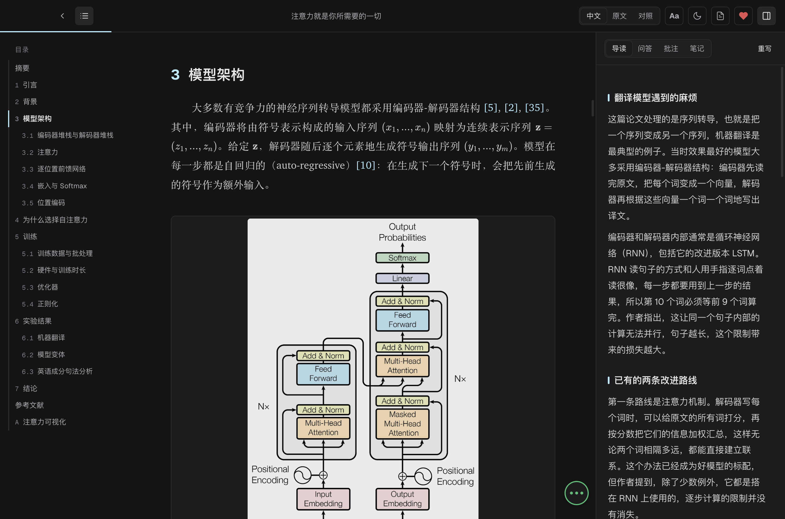
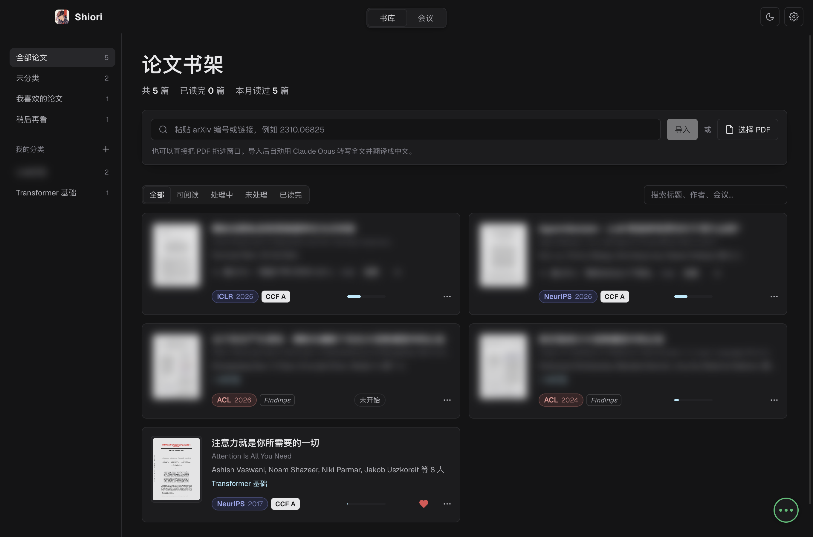
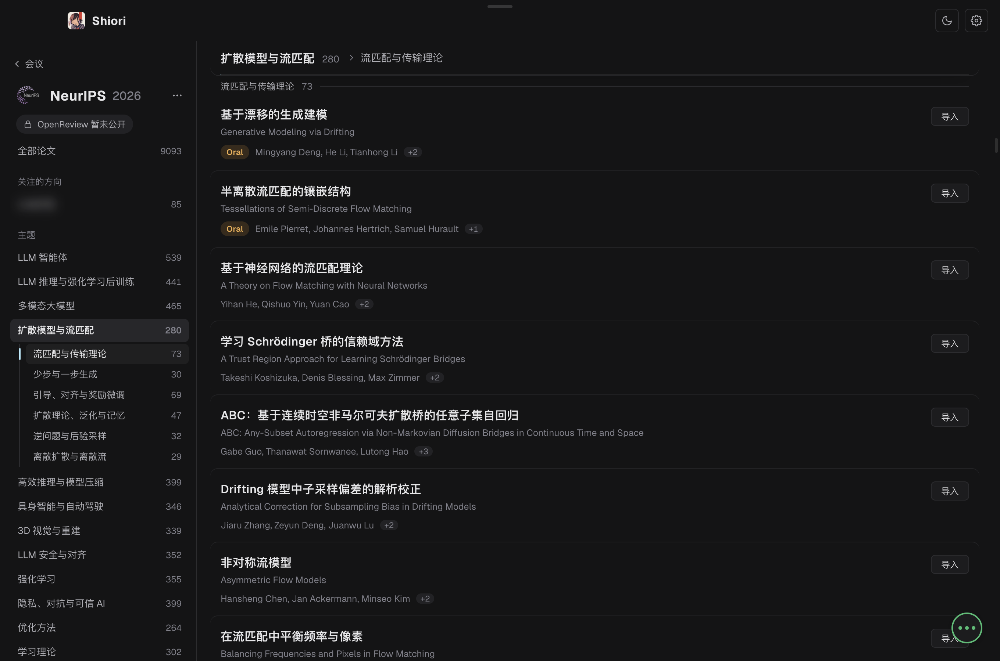
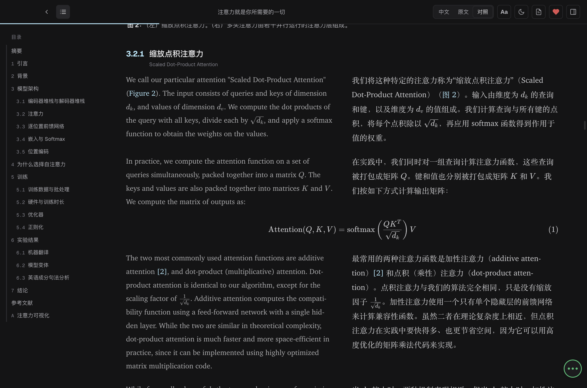
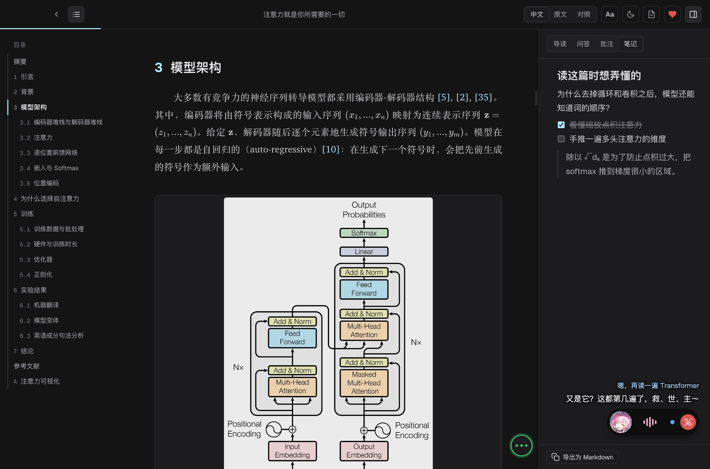
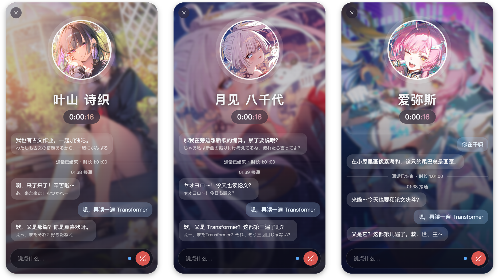

# Shiori 栞

**English** | [简体中文](README.zh-CN.md)

Shiori is a paper reader for macOS. Drop in a PDF or an arXiv link, and the AI you connect (Claude, ChatGPT or
DeepSeek) transcribes and translates the whole paper in the background. It comes back as a typeset Chinese–English article you can read, annotate and ask
questions about.



## Features

- **Readable papers** – PDFs are re-typeset as articles with figures, tables and KaTeX formulas, in Chinese,
  the original English, or side by side.
- **Reading guide** – the story of the paper before you read it: the problem and why it matters, what earlier work
  tried, the idea, and one concrete example.
- **Cross-references** – hover a figure, table, equation or citation to preview it; click to jump, swipe back to
  return.
- **Original page** – every paragraph links to its page in the PDF.
- **Highlights and notes** – four highlight colours and margin notes, plus a block-editor note for each paper with
  tables, formulas and images. Both export as Markdown.
- **Ask about it** – select any passage to have it explained or translated, or chat about the paper. Each paper
  keeps its own conversation.
- **Your choice of AI** – Claude or ChatGPT through your own subscription, or DeepSeek with an API key. Processing,
  questions and calls can each use a different model, each with its own thinking level.
- **Library** – arXiv import, reading progress, hearts for the papers you like, a watch-later list, and your own
  categories to file papers under, with one suggested for each paper. Venue tags and their CCF rank are looked up for
  you, technical reports carry their organisation's mark, and you can correct any of them.
- **Conferences** – follow the accepted papers of ICML, NeurIPS, ICLR, ACL and EMNLP, or any conference you add. The AI
  sorts each edition into a map of themes in Chinese and gives every title a Chinese translation. Follow research
  directions, keep papers for later, and import any of them into your library in one click; papers on OpenReview can
  be imported once you sign in.
- **Contacts** – keep a favourite character on the line while you read. They chat with you by voice, with Chinese
  subtitles, and tell you when a paper is ready. Personality, picture and voice are all yours to set. Voices need
  your own Fish Audio key.
- **Glossary** – your preferred translations of terms, used for every paper.
- **Themes and fonts** – light, dark and sepia; any installed font for the interface.

Three contacts come with the app, and are yours to change or delete like any other: Hayama Shiori, Shiori's own
character, Yachiyo Runami from *Cosmic Princess Kaguya!*, and Aemeath from *Wuthering Waves*. Yachiyo's and
Aemeath's pictures are non-commercial fan art; the characters belong to their rights holders.

## Screenshots

Your library, with your categories, hearts and venue tags:



An edition of a conference, its papers sorted by theme, with the themes down the side:



Chinese and the original English, side by side:



A call while you read, with subtitles on the desktop:



The call opened up, with the record of past calls. From left to right, the three contacts that come with the app:



## Requirements

- macOS on Apple silicon
- Node.js 20.19+ or 22.12+
- One AI service, any of:
  - [Claude Code](https://claude.com/claude-code), signed in with a Claude account
  - the [ChatGPT desktop app](https://chatgpt.com/download) or the Codex CLI, signed in with a ChatGPT account
  - Claude Code with a [DeepSeek](https://platform.deepseek.com) API key, no Claude account needed
- Optional: a [Fish Audio](https://fish.audio) API key, for the contacts' voices
- Optional: an [OpenReview](https://openreview.net) account, to import papers from OpenReview

## Getting started

```bash
git clone https://github.com/kuroha893/shiori.git
cd shiori
npm install
npm run dev
```

To build the app:

```bash
npm run pack
```

The app is written to `dist/mac-arm64/Shiori.app`.

On first launch, a welcome page walks you through connecting an AI service and, if you like, Fish Audio. Both can be
changed later in **Settings**. Papers are stored in `~/Documents/Shiori`, one folder per paper.

## Built with

Electron, React, pdf.js, KaTeX, markdown-it and Tiptap. AI through Claude Code and Codex, voices by Fish Audio, service
marks from LobeHub Icons (MIT). Fonts: Geist, Inter, Space Grotesk,
IBM Plex, Manrope and JetBrains Mono (SIL Open Font License).
