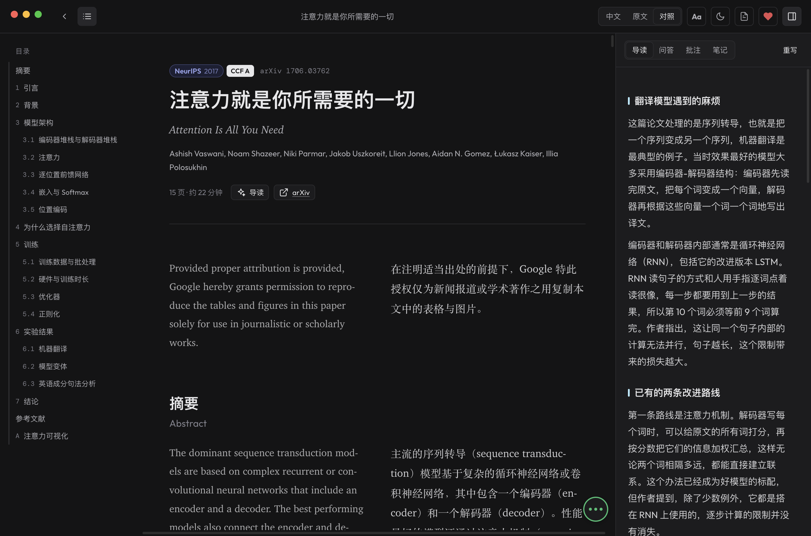
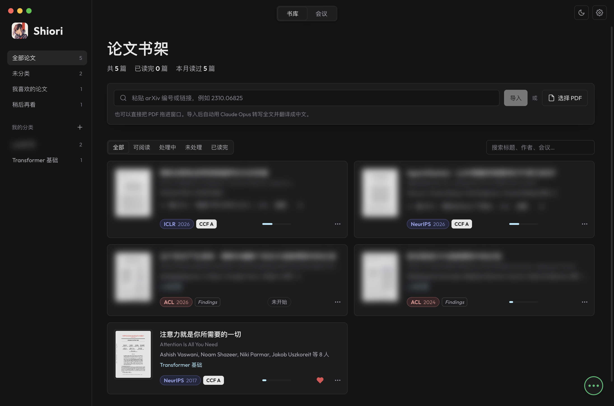
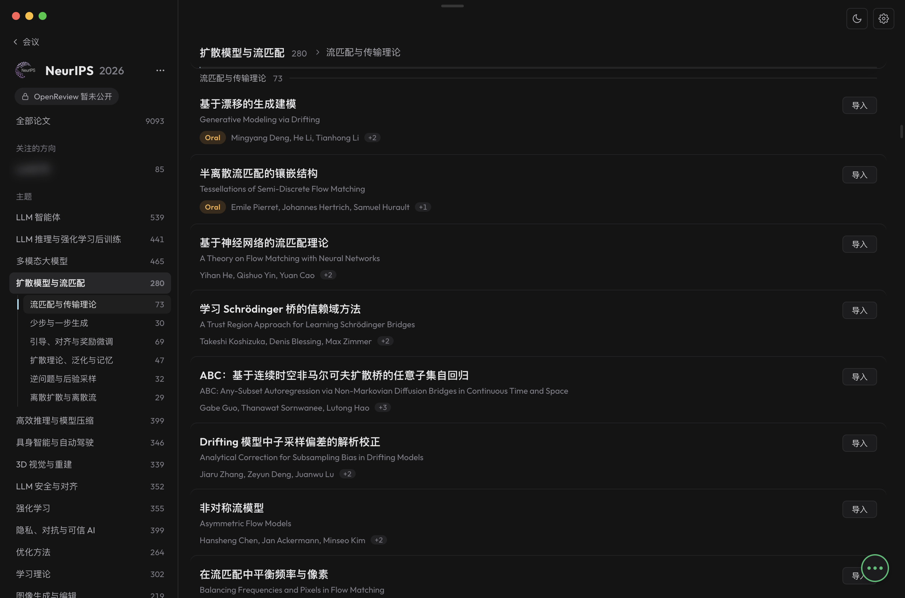
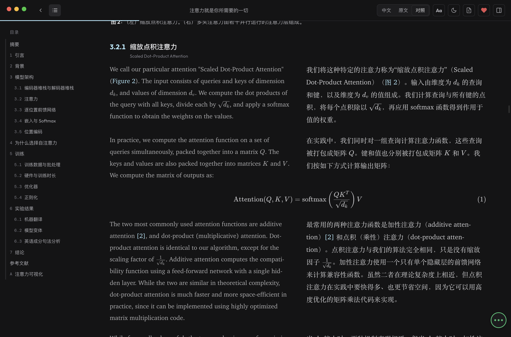
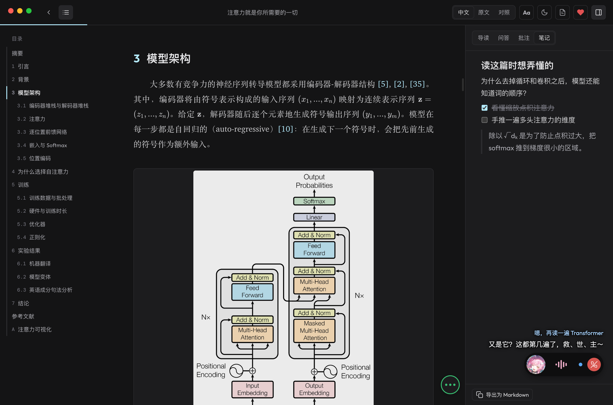

<p align="center">
  
</p>

<h1 align="center">Shiori 栞</h1>

<p align="center">macOS 上的中英双语 AI 顶会论文阅读器</p>

<p align="center"><a href="README.md">English</a> | <b>简体中文</b></p>

<br>



Shiori 是一款 macOS 上的论文阅读器。放入 PDF 或 arXiv 链接，你接入的 AI（Claude、ChatGPT 或 DeepSeek）会在后台转写并翻译整篇论文，把它变成一篇排好版的中英双语文章，你可以直接阅读、批注和提问。

## 功能

- **好读的论文**：PDF 重新排版成文章，图表和 KaTeX 公式都在，可以看中文、英文原文或双语对照。
- **导读**：读之前先了解这篇论文的来龙去脉：要解决什么问题、为什么重要、之前的研究做了什么、这篇的想法是什么，再配一个具体的例子。
- **交叉引用**：鼠标移到图、表、公式或引用上可以预览，点击跳转，双指滑动返回。
- **原文页面**：每一段都能跳到它在 PDF 里的那一页。
- **批注和笔记**：四种高亮颜色和批注，每篇论文还有一份块编辑器笔记，支持表格、公式和图片。两者都能导出为 Markdown。
- **随时提问**：选中任意段落，让 AI 解释或翻译，也可以就整篇论文聊天。每篇论文的对话单独保存。
- **自选 AI**：用你自己的 Claude 或 ChatGPT 订阅，或者填一个 DeepSeek API key。处理论文、问答和通话可以分别用不同的模型，各自设定思考程度。
- **书架**：支持 arXiv 导入和阅读进度，可以给喜欢的论文点红心、留着稍后再看，放进自己的分类（每篇都会给出建议）。会议标签和 CCF 等级会自动查找，技术报告显示机构标志，也可以手动修改。
- **会议**：跟踪 ICML、NeurIPS、ICLR、ACL 和 EMNLP 的录用论文，会议列表可以自己增减。AI 把每一届整理成中文主题目录，标题都配上中文。可以关注研究方向、稍后再看，一键导入书架；OpenReview 上的论文登录后也能导入。
- **联系人**：读论文的时候，和喜欢的角色挂个电话吧。TA 会用语音陪你聊天，配中文字幕，论文翻译好了也会告诉你。人设、立绘、声音都能自定义。语音需要自备 Fish Audio 密钥。
- **术语表**：设定你习惯的术语译法，所有论文都会遵循。
- **主题和字体**：浅色、深色和护眼三种主题，界面可以使用任意已安装的字体。

应用自带三位联系人，和其他联系人一样可以随意修改或删除：Shiori 自己的角色叶山诗织，来自《超时空辉夜姬！》的月见八千代，以及来自《鸣潮》的爱弥斯。八千代和爱弥斯的图片是非商业同人作品，角色版权归其权利人所有。

## 截图

书架，可以按自己的分类整理，还有红心和会议标签：



一届会议的论文按主题排好，左边是主题目录：



中文和英文原文逐段对照：



一边读论文一边通话，字幕直接显示在桌面上：



展开通话，可以看过去的通话记录。从左到右是三位自带联系人：


## 环境要求

- 搭载 Apple 芯片的 macOS
- Node.js 20.19+ 或 22.12+
- 一个 AI 服务，以下任选其一：
  - [Claude Code](https://claude.com/claude-code)，并已登录 Claude 账号
  - [ChatGPT 桌面版](https://chatgpt.com/download)或 Codex CLI，并已登录 ChatGPT 账号
  - Claude Code 加一个 [DeepSeek](https://platform.deepseek.com) API key，不需要 Claude 账号
- 可选：一个 [Fish Audio](https://fish.audio) API key，用于联系人的语音
- 可选：一个 [OpenReview](https://openreview.net) 账号，用于导入 OpenReview 上的论文

## 开始使用

```bash
git clone https://github.com/kuroha893/shiori.git
cd shiori
npm install
npm run dev
```

打包 App：

```bash
npm run pack
```

生成的 App 在 `dist/mac-arm64/Shiori.app`。

首次启动时，欢迎页会带你接入一个 AI 服务，也可以顺便接入 Fish Audio，之后都能在**设置**里修改。论文保存在 `~/Documents/Shiori`，每篇一个文件夹。

## 技术栈

Electron、React、pdf.js、KaTeX、markdown-it 和 Tiptap。AI 通过 Claude Code 和 Codex 运行，语音由 Fish Audio 提供，服务图标来自 LobeHub Icons（MIT 许可）。字体：Outfit、Geist、Inter、Space Grotesk、IBM Plex、Manrope 和 JetBrains Mono（SIL 开源字体许可）。
