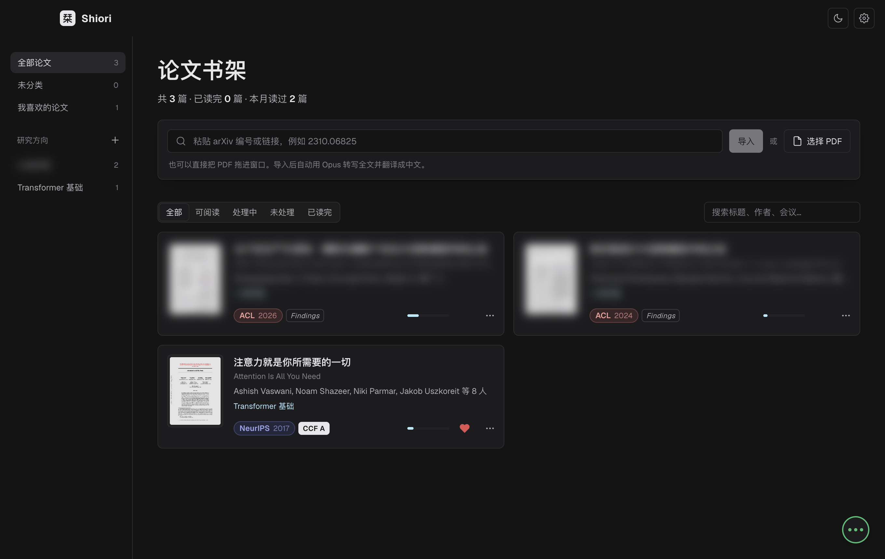
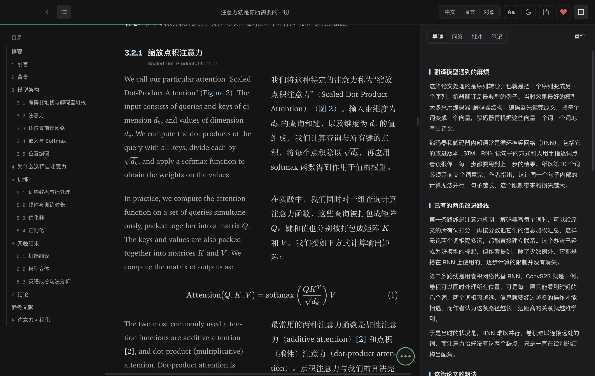
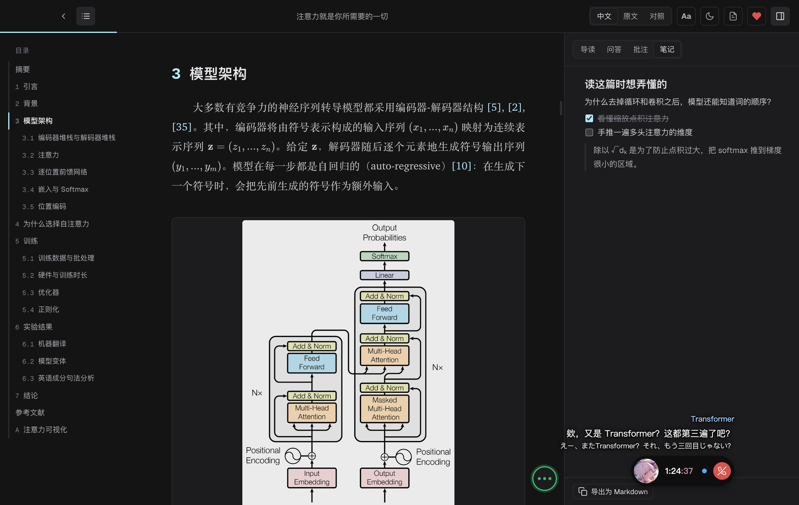

# Shiori 栞

[English](README.md) | **简体中文**

Shiori 是一款 macOS 上的论文阅读器。放入 PDF 或 arXiv 链接，Claude 会在后台转写并翻译整篇论文，把它变成一篇排好版的中英双语文章，你可以直接阅读、批注和提问。


## 功能

- **好读的论文**：PDF 重新排版成文章，图表和 KaTeX 公式都在，可以看中文、英文原文或双语对照。
- **导读**：读之前先了解这篇论文的来龙去脉：要解决什么问题、为什么重要、之前的研究做了什么、这篇的想法是什么，再配一个具体的例子。
- **交叉引用**：鼠标移到图、表、公式或引用上可以预览，点击跳转，双指滑动返回。
- **原文页面**：每一段都能跳到它在 PDF 里的那一页。
- **批注和笔记**：四种高亮颜色和批注，每篇论文还有一份块编辑器笔记，支持表格、公式和图片。两者都能导出为 Markdown。
- **问 Claude**：选中任意段落，让它解释或翻译，也可以就整篇论文聊天。每篇论文的对话单独保存。
- **书架**：支持 arXiv 导入和阅读进度，可以给喜欢的论文点红心，按研究方向归类（Claude 会给出建议），还会显示会议标签和 CCF 等级。
- **联系人**：读论文的时候，和喜欢的角色挂个电话吧。TA 会用语音陪你聊天，配中文字幕，论文翻译好了也会告诉你。人设、立绘、声音都能自定义。语音需要自备 Fish Audio 密钥。
- **术语表**：设定你习惯的术语译法，所有论文都会遵循。
- **主题和字体**：浅色、深色和护眼三种主题，界面可以使用任意已安装的字体。

内置了一位默认联系人：来自《超时空辉夜姬！》的月见八千代。她的图片是非商业同人作品，角色版权归其权利人所有。

## 截图

书架，可以按研究方向归类，还有红心和会议标签：



中文和英文原文逐段对照：



一边读论文一边通话，字幕直接显示在桌面上：



展开通话，可以看过去的通话记录：


## 环境要求

- 搭载 Apple 芯片的 macOS
- Node.js 20.19+ 或 22.12+
- [Claude Code](https://claude.com/claude-code)，并已登录 Claude 账号

## 开始使用

```bash
git clone https://github.com/kuroha893/shiori.git
cd shiori
npm install
npm run dev
```

打包 App：

```bash
npm run pack
```

生成的 App 在 `dist/mac-arm64/Shiori.app`。

首次启动后，打开**设置 → Claude**，确认已找到 Claude Code 并完成登录。论文保存在 `~/Documents/Shiori`，每篇一个文件夹。

## 技术栈

Electron、React、pdf.js、KaTeX、markdown-it 和 Tiptap。语音由 Fish Audio 提供。字体：Geist、Inter、Space Grotesk、IBM Plex、Manrope 和 JetBrains Mono（SIL 开源字体许可）。
